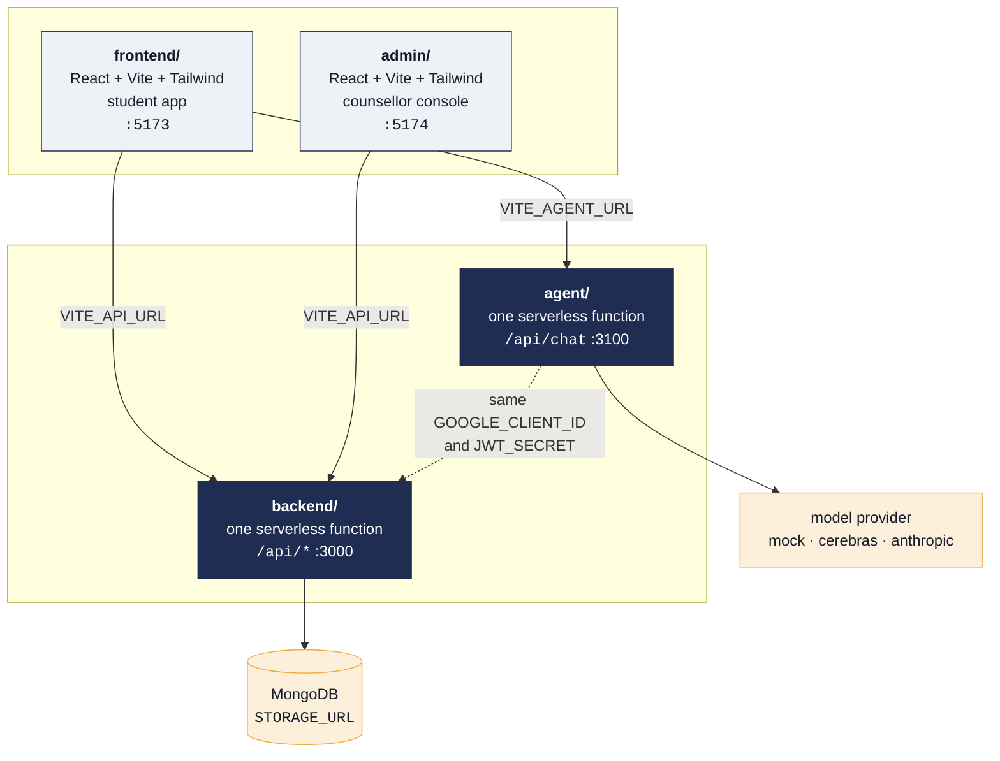
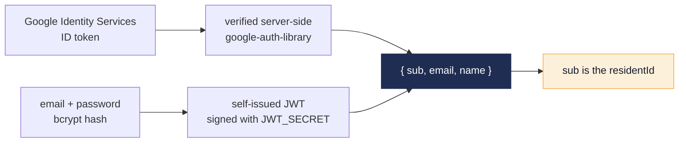

<div align="center">

# Architecture

### Four deployable modules, one repo, and one serverless function doing all the routing


[prd](prd.md) · **architecture** · [rules](rules.md) · [design](design.md) · [tasks](tasks.md) · [memory](memory.md) · [readme](README.md)

</div>

---

## 1. The map



Each module has its own `package.json` and deploys as its own Vercel project,
all four pointed at this one repo with a different **Root Directory**.

| Module | Stack | Serves | Dev port |
| :--- | :--- | :--- | :---: |
| `frontend/` | React, Vite, Tailwind | The student app and the public landing page | `5173` |
| `admin/` | React, Vite, Tailwind | The counsellor console, its own window | `5174` |
| `backend/` | Node 22, one function | Everything under `/api` | `3000` |
| `agent/` | Node 22, one function | `/api/chat` only | `3100` |

> [!WARNING]
> `VITE_API_URL` and `VITE_AGENT_URL` are inlined by Vite **at build time**.
> Changing either means redeploying the app that reads it, not just setting the
> variable. A frontend that was built before `VITE_AGENT_URL` existed keeps
> calling its own origin, and the chat 404s while everything else looks fine.

## 2. One function, not nineteen

Every `/api/*` request goes through a single serverless function,
`backend/api/router.js`, which looks the path up in `backend/lib/routes.js` and
calls the matching handler from `backend/handlers/`. The rewrite in
`vercel.json` sends everything there and passes the original path in `?path=`.

**Adding a route is one line in `lib/routes.js` plus a file in `handlers/`.**
The function count stays at one no matter how many routes exist.

<details>
<summary>Why it is built this way, in three failures</summary>

<br>

**Failure one: the filesystem catch-all.** `api/[...path].js` is the shape you
reach for first. It deployed as though it were a single-segment `[param]`, so
`/api/checkins` resolved and `/api/auth/login` returned the platform's own 404.
Sign-in broke while the pages either side of it looked fine.

**Failure two: the twelve function cap.** The obvious layout, one file per
route under `api/`, is what this was. Vercel's Hobby plan allows **12
functions per deployment**. At 19 routes, every deploy built successfully and
then failed while shipping, so production silently stayed on the last build
small enough to deploy while the repo moved on for weeks. Routes added in that
window returned the platform's own 404, which carries no CORS headers, so the
browser blocked it and the app reported the server as unreachable rather than
the route as missing.

**Failure three: two route tables.** Routing used to live in `dev-server.js`
for local work while production got it from the filesystem. The two drifted,
and `/api/health`, the check the README recommends, answered on a laptop and
404'd in production. `dev-server.js` now reads the same table, so a route
cannot exist locally and not in production.

</details>

## 3. The route table

Source of truth: [`backend/lib/routes.js`](backend/lib/routes.js).

| Route | Access | Handler |
| :--- | :--- | :--- |
| `/api/health` | **Public**, touches neither auth nor storage | inline |
| `/api/preview` | **Public** on purpose: one questionnaire, no account, nothing stored | `preview.js` |
| `/api/enquiries` | **POST public**, GET is super admin | `enquiries.js` |
| `/api/auth/signup` `login` `forgot` `reset` `password` | Public | `handlers/auth/` |
| `/api/checkins` | Student | `checkins.js` |
| `/api/profile` | Student | `profile.js` |
| `/api/sharing` | Student | `sharing.js` |
| `/api/assessments` | Student | `assessments.js` |
| `/api/grounding` | Student | `grounding.js` |
| `/api/paths` | Student | `paths.js` |
| `/api/inkblot-test` | Student | `inkblot-test.js` |
| `/api/chat-log` | Student | `chat-log.js` |
| `/api/caregiver/residents` `resident` | Caregiver allowlist | `handlers/caregiver/` |
| `/api/admin/me` `role` `overview` `residents` `resident` `audit` | Staff, role-gated | `handlers/admin/` |
| `/api/admin/staff` `team` `assign` | **Super admin only** | `handlers/admin/` |

A trailing slash is the same route. Nothing else is guessed at.

## 4. Where the logic lives

| Concern | File |
| :--- | :--- |
| Route table | `backend/lib/routes.js` |
| Auth, role gates | `backend/lib/auth.js` |
| Flagging heuristic | `backend/lib/logic.js` |
| Instrument definitions, items, scales, licence | `backend/lib/instruments.js` |
| Scoring: sum, transform, band | `backend/lib/scoring.js` |
| Grounding practices | `backend/lib/grounding.js` |
| Paths and their bookend guards | `backend/lib/paths.js` |
| Crisis screening | `backend/lib/safety.js` **and** `agent/lib/safety.js`, kept identical |
| Chat topic filing | `backend/lib/topics.js` |
| Who may see a student | `backend/lib/sharing.js` |
| Storage adapter | `backend/lib/store.js` |
| CORS, rate limit, sanitize, phone | `backend/lib/` |
| Model providers | `agent/lib/provider.js`, with `cerebras.js`, `gemini.js`, `groq.js` |
| Persona and safety protocol | `agent/lib/persona.js` |

Frontend features are one directory each under `frontend/src/features/`:
`home`, `checkin`, `assessments`, `grounding`, `paths`, `inkblot`, `companion`,
`read`, `profile`, `auth`, `caregiver`. Routes are declared in
`frontend/src/routes/AppRoutes.jsx`. The console's screens are
`admin/src/pages/`: Dashboard, Residents, ResidentDetail, Team, Enquiries,
SignIn, RolePicker, PendingApproval.

## 5. Auth



Both paths produce the same shape, so nothing downstream cares which was used.
The app additionally asks once for phone, date of birth, address and occupation
through the account form, since auth alone does not cover those. **The phone
number is contact detail for the console to call on. It is not a way in.**

Roles are enforced server-side in `backend/lib/auth.js` by `requireStudentAccess`
and `requireTeamAccess`, never in the UI alone.

> [!CAUTION]
> `agent/` verifies the same sessions, so it needs the **same**
> `GOOGLE_CLIENT_ID` and `JWT_SECRET` as `backend/`. A different `JWT_SECRET`
> rejects every signed-in user with "invalid signature", and the failure looks
> like a broken chat rather than a config mismatch.

## 6. Storage

`backend/lib/store.js` is the only module that touches persistence.

| `STORAGE_URL` | Backing store | Use |
| :--- | :--- | :--- |
| Set | MongoDB, Atlas or another Vercel Marketplace provider | Production |
| Unset | `backend/.data/db.json`, gitignored | Local dev only |

> [!WARNING]
> An unset `STORAGE_URL` in production means check-ins **silently do not
> persist**. Vercel's filesystem is read-only outside `/tmp`, and `/tmp` does
> not survive between requests. Connect storage with the default `STORAGE`
> prefix so it lands in `STORAGE_URL`, then redeploy.

The access log is append-only by design: `/api/admin/audit` accepts GET and
POST and nothing else, and the store never deletes. It records **that** a
record was opened or exported, never what was in it, because a log holding
copies of the data it protects is a second copy of the problem.

It is the one collection read by recency rather than in full, via
`readRecent()`, because it gains a row every time anybody opens anybody's
record. Reading all of it to show eight rows is the kind of thing that works
for a year and then does not. The collection is still named `exportLog`:
renaming a live collection buys a migration to gain a better noun, and `kind`
is what actually distinguishes an entry.

Reading it back is **scoped**. The log names students, so the super admin sees
every access and everyone else sees only their own actions. Handing the whole
log to every counsellor would have made the audit log itself the widest leak in
the console.

## 7. Running it

```bash
npm run install:all   # once
npm run dev           # all four, prefixed output, restarts any that exits
npm test              # 30 suites across backend, frontend and admin
```

`npm run dev` is the one to use. The two Vite apps fail loudly when they are
down, but a missing backend leaves a perfectly working-looking app where every
tab reads "Can't reach the server", and a missing agent leaves one where only
the chat says it.

<details>
<summary>Running the four separately</summary>

<br>

```bash
cd backend && npm run dev:local   # plain Node on :3000, no Vercel login needed
cd agent   && npm run dev:local   # plain Node on :3100, /api/chat only
cd frontend && npm run dev        # Vite :5173, proxies /api to :3000, /api/chat to :3100
cd admin    && npm run dev        # Vite :5174, proxies /api to :3000
```

`backend/ npm run dev` uses `vercel dev` instead, which needs `vercel login`
first. Slower to start, closer to the real runtime.

</details>

`curl http://localhost:3000/api/health` answers `{"ok":true}` without a
sign-in. It is the quickest way to tell "the server is down" from "the server
said no".

## 8. Environment variables

| Variable | Where | Notes |
| :--- | :--- | :--- |
| `GOOGLE_CLIENT_ID` | backend, agent | Same value in both |
| `VITE_GOOGLE_CLIENT_ID` | frontend, admin | Same Client ID again |
| `JWT_SECRET` | backend, agent | **Must match** |
| `STORAGE_URL` | backend | Unset means a local JSON file |
| `ALLOWED_ORIGIN` | backend, agent | Comma-separated. Lock it down once the URLs exist |
| `VITE_API_URL` | frontend, admin | The backend's deployed URL |
| `VITE_AGENT_URL` | frontend | The agent's deployed URL |
| `ADMIN_EMAILS` | backend | Falls back to `CAREGIVER_EMAILS` |
| `CAREGIVER_EMAILS` | backend | Comma-separated allowlist |
| `SUPER_ADMIN_EMAILS` | backend | Opens the console without being on `ADMIN_EMAILS` |
| `AGENT_PROVIDER` | agent | `mock`, `cerebras` or `anthropic` |
| `CEREBRAS_API_KEY` / `ANTHROPIC_API_KEY` | agent | Only for the matching provider |

The Google OAuth Client needs **every** origin listed: `http://localhost:5173`,
`http://localhost:5174`, and both deployed URLs. Google checks the origin, and
a missing one means the Google button simply does not render.

> [!NOTE]
> Environment variables only take effect on a deployment made **after** they are
> set. A failed deploy leaves the old one serving, and the old one has the old
> variables. Vite also reads `.env.local` once at startup, so restart the dev
> server after editing it.

## 9. Deploy order

1. **Backend**, so you have its URL. Connect storage, set env vars, redeploy.
2. **Frontend**, with `VITE_API_URL` and `VITE_GOOGLE_CLIENT_ID`.
3. **Admin**, same shape, its own project. Add its URL to the OAuth origins.
4. **Agent**, the easy one to forget, because nothing else breaks without it.
   Only `/api/chat` fails, so the app looks healthy and the chat alone reports
   an unreachable server. Then set `VITE_AGENT_URL` on the frontend and
   **redeploy the frontend**.
5. Back to the backend: set `ALLOWED_ORIGIN` to the frontend and admin URLs and
   redeploy, so CORS is locked down instead of the fallback list.

> [!NOTE]
> `ALLOWED_ORIGIN` is the **whole** list once it is set. While it is unset, the
> backend falls back to `https://*.vercel.app` and `http://localhost:*` so dev
> and preview deployments work with no configuration. Setting it replaces that
> fallback rather than adding to it, so a production deployment is not left
> reachable from any vercel.app subdomain. If you want previews to keep
> working against production, add `https://*.vercel.app` to `ALLOWED_ORIGIN`
> yourself. An entry may contain one `*`, which stands in for a single label
> and never for a path.
